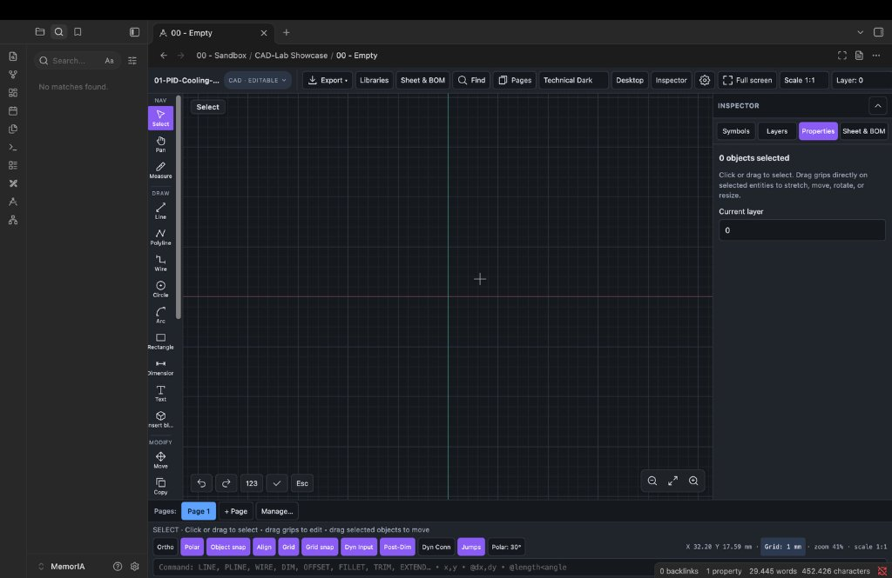
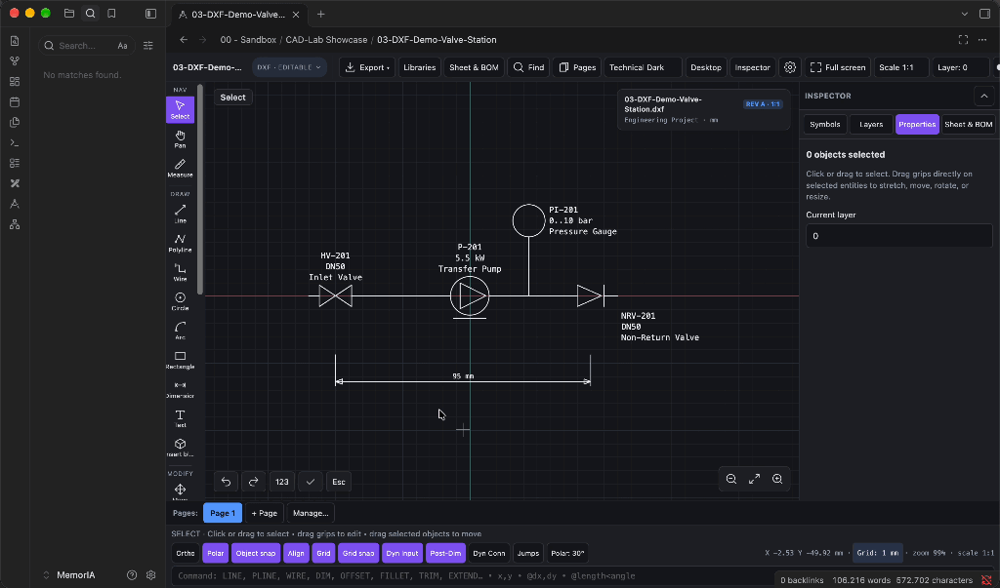
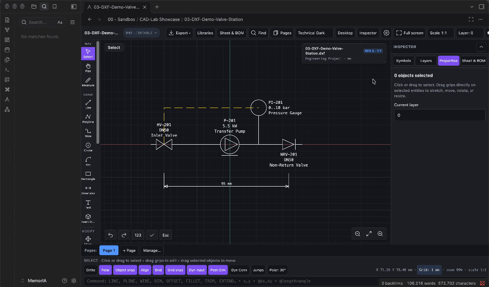

# CAD-Lab

[-7c3aed)](https://obsidian.md)

**CAD-Lab** brings deterministic, millimeter-precision vector CAD directly into **Obsidian**—designed for **P&ID (Process and Instrumentation Diagrams)** and **electrical single-line & multi-line schematics**. Drawings live as human-readable `.cad.md` Markdown notes inside your vault with an automatically synchronized **Bill of Materials (BOM)** table, native **AutoCAD R2010 DXF** workflows, and true-scale **Vector PDF** export.

> **100% Local-First & Offline:** Zero runtime dependencies outside Obsidian and standard Web APIs—no telemetry, no cloud servers, and no Node/Electron-only requirements. The exact same plugin bundle runs smoothly on **macOS / Windows / Linux** and **iPadOS (Apple Pencil + touch gestures)**.

---

## Preview

---

## Key Features

- **Millimeter Vector Engine (`mm`)**: Exact `float64` world coordinates, analytic OSNAP (`Endpoint`, `Midpoint`, `Center`, `Intersection`, `Port`), Polar Tracking, Ortho, Grid Snap (`F9`), and zoom-independent precision.
- **231 Built-in Standards Symbols & Library Manager**: Organized across **P&ID** (`ANSI/ISA-5.1`, `BS 1646`, `DIN 28004`, `ISO 10628`, `ISO 14617`), **Electrical Single-Line & Multi-Line** (`IEC 60617`, `IEC 62271-1 / EN 62271-200`, `ANSI Y32`, `NFPA 79`), and **General** (`ISO 128`), plus custom `.cad-library.json` creation and `.dxf` symbol import.
- **Intelligent Wires & Flow Humps**: Orthogonal wires attached to symbol ports auto-reroute when blocks move or rotate; configurable **Visio-style cross-over jumps**, arrow placements (`Start`, `End`, `Both`, `Middle`, `Every L/N`), and custom dash spacing.
- **Direct DXF Editing & Duplicate-Free Conversion**: Open `.dxf` files in Obsidian and choose directly from the top badge dropdown (`DXF · READ ONLY ▾`) whether to **Edit DXF directly** in place (`R2010`), **Convert to `.cad.md`** (with the option to trash the source `.dxf` cleanly), or switch back to **Read Only**.
- **Unidirectional Bill of Materials (BOM)**: Every `.cad.md` note embeds a Markdown BOM table (`Tag`, `Symbol`, `Brand`, `Model`, `Standard`, `Value`, `Description`, `Layer`, `Notes`) automatically synced from the canvas (`Graphic → Table`).
- **Multi-Page Sheets, ISO/ANSI Title Blocks & Vector PDF**: Standard `A4–A0` / `ANSI A–D` borders, ISO 7200 / ANSI Y14.1 title blocks, multi-page tabs, search with layer highlighting (`FIND`), and true-scale multi-page **Vector PDF 1.4** output.
- **Tablet & Apple Pencil Native Ergonomics**: Dedicated `Pen draws · fingers navigate` mode with 1-finger pan, 2-finger pinch-zoom, 2-finger tap **Undo**, 3-finger tap **Redo**, configurable Apple Pencil hold-loupe, and floating **123** precision numpad.

---

## Installation

### From Obsidian Community Plugins *(once listed)*
1. Open **Settings → Community plugins → Browse**.
2. Search for **CAD-Lab**, click **Install**, then **Enable**.

### Manual Installation (GitHub Release)
1. Download `main.js`, `manifest.json`, and `styles.css` from the [latest GitHub Release](https://github.com/ide-ale/obsidian-cad-lab/releases/latest).
2. Copy them into `<your-vault>/.obsidian/plugins/cad-lab/`.
3. Reload Community Plugins in Obsidian and enable **CAD-Lab**.

*(For development builds into local vaults, `npm run deploy` compiles production `main.js` and updates configured vaults while creating automatic backups.)*

---

## Getting Started & Mode Switcher

Click the drafting compass ribbon icon or run **CAD-Lab: Create new CAD / P&ID drawing** from the Command Palette.

Use the interactive status pill in the top bar at any time:

- **`CAD · EDITABLE ▾`**: Full editing enabled on `.cad.md` notes. Click the badge to temporarily lock the view (`Switch to Read Only`) and prevent accidental edits.
- **`CAD · READ ONLY ▾`**: Safe inspection mode for `.cad.md` notes. Click the badge and choose **Edit CAD drawing** to resume editing.
- **`DXF · READ ONLY ▾`**: Source `.dxf` / binary `.dwg` safe view. For ASCII `.dxf` files, click the badge (or banner buttons) to choose **Edit DXF directly** (saves straight back into the `.dxf` file in R2010 without creating duplicates) or **Convert to `.cad.md…`** (creates a full Markdown CAD note with YAML, BOM & multi-page tabs, optionally trashing the original `.dxf`).
- **`DXF · EDITABLE ▾`**: Direct R2010 `.dxf` editing active. Click the badge to **Convert to `.cad.md…`** or **Switch to Read Only**.

---

## Commands, Shortcuts & Exact Input

Most tools accept both toolbar/ribbon clicks and AutoCAD-style keyboard commands (`dx,dy`, `@dx,dy`, `@length<angle`), with customizable keyboard shortcuts (`F3` OSNAP, `F8` ORTHO, `F9` Grid Snap) and mouse button/wheel bindings in **Settings**.

| Tool | Command / alias | Usage |
| --- | --- | --- |
| Line | `LINE`, `L` | First point, next endpoint; Enter finishes (single or chained) |
| Polyline | `PLINE`, `PL` | Pick vertices; `CLOSE` closes loop; `U` undoes last vertex; Enter finishes |
| Intelligent wire | `WIRE`, `W` | Connect block port to port/point with automatic orthogonal rerouting |
| Dimension (mm) | `DIM`, `DIMENSION`, `D` | First & second extension point (`aligned`, `horizontal`, `vertical`, `Ø`, `R`) |
| Circle / Arc / Rectangle | `C` / `A` / `REC` | Center & radius, center/start/end angle, or opposite corners |
| Text | `T` | Insertion point, text content, millimeter height, and rotation |
| Insert symbol | `I` | Pick symbol from standard hierarchy, then place on canvas |
| Move / Copy | `M` / `CO` | Grab & drag directly; Copy places at pointer and auto-increments BOM `TAG` (`XV4 → XV5`) |
| Rotate / Scale / Mirror | `RO` / `SC` / `MI` | Rotate around base point, scale uniformly, or mirror across two axis points |
| Match Properties | `MA`, `MATCHPROP` | Pick source object, then apply layer, color, linetype, and styles to targets |
| Offset | `O`, `OFFSET` | Offset inside, outside, or both sides simultaneously with live preview |
| Trim / Extend | `TR` / `EX` | Select cutting boundary line, then click segment to trim or extend |
| Fillet / Join / Bridge | `F` / `J` | Corner fillet between lines, join chains, or toggle individual cross-over bridges |
| Find / Print | `FIND` / `PRINT` | Search objects/BOM tags highlighting **Layer**, or rescale & print standard sheets |

---

## File Formats & Unidirectional BOM

Every `.cad.md` note follows a clean, inspectable Markdown layout:

1. **Minimal YAML Frontmatter**: `cad-lab: true` (drawing scale, units, and component tags are kept clean unless you opt into project preset properties).
2. **Markdown Prose & Unidirectional BOM Table**: Between `<!-- cad-bom:start -->` and `<!-- cad-bom:end -->`, CAD-Lab generates a structured BOM table (`#`, `Tag`, `Component / Symbol`, `Brand`, `Model`, `Standard`, `Category`, `Value / Rating`, `Description`, `Attributes`, `Layer`, `Notes`) strictly synchronized from the schematic (`Graphic → Table`).
3. **Fenced `cad-data` Block**: Validated millimeter JSON model storing layers, custom linetypes, symbols, multi-page sheets, dimensions, and title blocks.

---

## DXF / DWG & True-Scale Vector PDF Export

- **Vector PDF**: Export **Vector PDF (in scale)** or **Print / Fit to Standard Paper…** via **Export ▾** to generate native multi-page **PDF 1.4** files with exact millimeter scaling, dash patterns, flow jumps, arrowheads, borders, and title blocks.
- **DXF & DWG**: Export standards-compliant ASCII AutoCAD R2010 (`AC1024`) with `TABLES`, `BLOCKS`, `ATTRIB`/`ATTDEF`, `DIMENSION`, linetypes, and `OBSIDIAN_CAD` XDATA. Import supports `.dxf` and ASCII `.dwg`; binary AutoCAD `.dwg` containers (`AC1009–AC1032`) are inspected losslessly to show DWG release metadata, binary sections, and embedded preview thumbnails.

---

## Support

If you find **CAD-Lab** useful for your engineering schematics, P&ID documentation, or field work in Obsidian, you can support ongoing development on Ko-fi:

---

## Author & License

Written and maintained by **Alessandro Abrami** ([github.com/ide-ale/obsidian-cad-lab](https://github.com/ide-ale/obsidian-cad-lab)).

Released under the [GNU Affero General Public License v3.0 (AGPL-3.0)](LICENSE).
